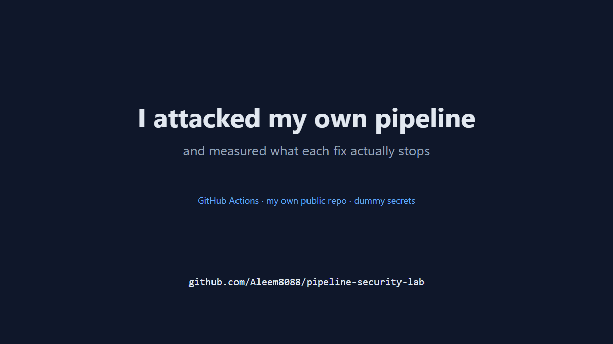
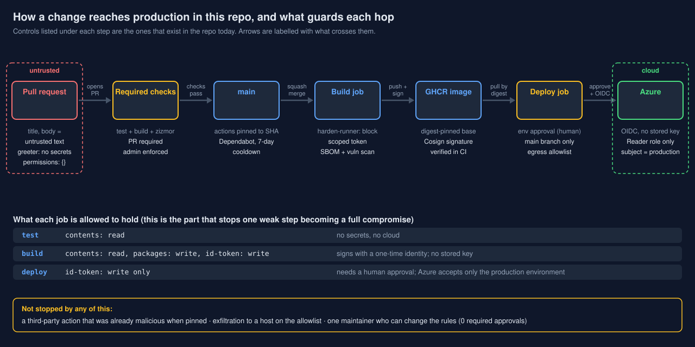

# I attacked my own pipeline

A tiny Node service and a GitHub Actions setup that started **deliberately insecure**. I attacked it on my own repo with dummy secrets, fixed one weakness at a time, and measured what each fix did and did not stop.



> Defensive and educational. Only my own repo and accounts are involved. The "secrets" are dummy canary values that unlock nothing. Cloud resources were created for the demos and torn down afterwards.

## Result

Measured on this repo, 2026-11-27. Every row names its source in [docs/scoreboard.md](docs/scoreboard.md).

| | Before | After |
|---|---|---|
| zizmor findings, the two scored workflow files (regular persona) | 10 (8 high, 2 medium) | **0** |
| same files, auditor persona | 21 (9 high, 6 medium) | **6** (0 high, 0 medium) |
| `GITHUB_TOKEN` scopes in the test job | 17 write + 3 read | **0 write + 2 read** |
| Stored cloud credentials | 1 | **0** (Azure OIDC) |
| Secrets exposed by the crafted PR title | 1 | **0** |
| Image scan rows (one scan each) | 178 | **28** (all Alpine OS packages) |
| Who can change `main` | anyone with write access | PR plus 3 required checks, admin enforced |

Read the caveats before quoting these: one small repo, mostly one run each, not a benchmark. The whole-repo auditor count is higher than the baseline only because I added demo workflows that are weak on purpose.

## How a change reaches production now



In the real pipeline, untrusted input (a pull request's text) never meets a secret. The `demo-*` workflows break that rule on purpose. The only path to the cloud is a short-lived OIDC token, and only for a job that a human approved and that runs from `main`. Diagram source: [docs/diagrams/make_diagrams.py](docs/diagrams/make_diagrams.py).

## What I attacked, and what fixed it

| Weakness (before state) | Demonstrated in | Fix | Doc |
|---|---|---|---|
| PR title pasted into a shell script, on a trigger that has secrets | [docs/demos.md](docs/demos.md) | pass text via `env:`, drop the secret, use `pull_request` | [Fix 3](docs/fixes.md) |
| Third-party actions on movable tags | [docs/demos.md](docs/demos.md) | pin to full commit SHAs, Dependabot with a 7-day cooldown | [Fix 1](docs/fixes.md) |
| `permissions: write-all` | [docs/demos.md](docs/demos.md) | `permissions: {}` plus per-job minimums | [Fix 2](docs/fixes.md) |
| Long-lived cloud credential in repo secrets | explained, not staged | Azure OIDC, subject limited to one environment, Reader role | [Fix 4](docs/fixes.md) |
| Nothing checks workflow changes | PR #9 | zizmor as a required check; harden-runner egress allowlists | [Tooling](docs/fixes.md) |
| Unsigned, unscanned image | scan before/after | digest-pinned base, SBOM, vulnerability scan, keyless Cosign signature | [Tooling](docs/fixes.md) |
| Anyone with write access can change `main` or deploy | PR #12 | branch protection, production approval, main-only deploys | [Step 8](docs/fixes.md) |
| AI agent reading untrusted text while holding secrets | [docs/ai-injection.md](docs/ai-injection.md) | split the reader (no secret, no tools) from the privileged step; validate output | [Step 9](docs/ai-injection.md) |

The AI step uses a **simulated** agent, not a real model. It shows the pipeline shape, not that any specific product is vulnerable.

## Read next
- [docs/scoreboard.md](docs/scoreboard.md): every number and how it was measured.
- [docs/threat-model.md](docs/threat-model.md): nine attack paths, what each control does not stop, residual risks.
- [docs/fixes.md](docs/fixes.md): each change with its evidence, including mistakes.
- [docs/measurements/](docs/measurements/): raw tool output.

## What is still not solved
- One maintainer operates every control, and required approvals are 0. A second reviewer is the biggest missing control.
- A third-party action that was already malicious when I pinned it still runs.
- Domain allowlists cannot see data sent to an allowed host such as github.com.
- Protection rules live in settings and can be changed without a pull request.
- Not tested: force-push blocking, fork pull requests, a real AI product.
- While testing branch protection I merged a deliberately risky PR (#9) by mistake because admin enforcement was still off. It sat on `main` for about 41 seconds, never ran, and was removed. Details in [docs/fixes.md](docs/fixes.md).

Some pull requests (#1, #7, #8) stay open on purpose as evidence of the before and after runs.

## Run it
```bash
npm ci && npm test
npm start     # http://localhost:3000
```
The `demo-*` workflows are manual or illustrative. The Azure scripts in [infra/](infra/) create and delete resources in whichever subscription you are logged into, so read them first. The `before-state` tag is the original deliberately insecure version.

Rebuild the diagrams (needs Python with Pillow and Microsoft Edge):
```bash
python docs/diagrams/make_diagrams.py
```

## Sources
Research notes and links were checked against the primary pages; the AI-injection work builds on [Aikido's PromptPwnd](https://aikido.dev/blog/promptpwnd-github-actions-ai-agents) and [SecurityWeek's coverage of "Comment and Control"](https://www.securityweek.com/claude-code-gemini-cli-github-copilot-agents-vulnerable-to-prompt-injection-via-comments/). Tools used: [zizmor](https://github.com/zizmorcore/zizmor), StepSecurity harden-runner, Anchore Syft and Grype, Sigstore Cosign, Dependabot.
